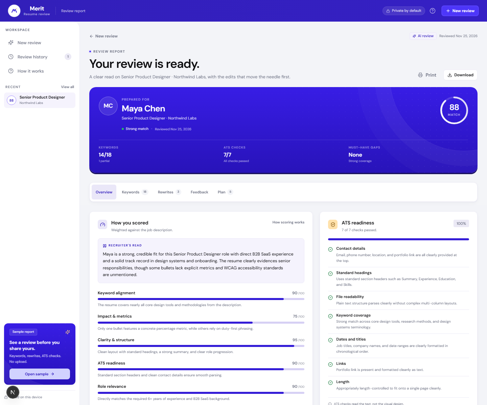
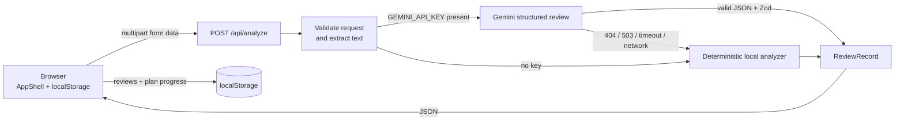

# Merit

**Make your resume earn the read.**

Merit is a full-stack AI resume reviewer. Add a resume and a real job description, and Merit returns a focused report: an overall match score, keyword gaps, ATS checks, missing skills, stronger bullet rewrites, section feedback, and a five-step action plan.

It is built to be useful even when the AI is not available. With a Gemini API key, Merit uses Gemini's structured output; without one — or if Gemini is overloaded — it falls back to a deterministic local analyzer and clearly labels the result. There is no fake "AI" mode and no invented resume experience.



> The screenshot uses Merit's fictional sample candidate. No real resume data is shown.

---

## Why this project exists

Most resume tools are good at producing confident-sounding advice. They are less good at being specific, honest, and useful on the next edit.

Merit was built around four product principles:

| Principle | What it means in the product |
| --- | --- |
| **Evidence over invention** | The review quotes the resume, never invents employers, titles, tools, or metrics. When a number is missing, rewrites use a bracketed placeholder such as `[X%]`. |
| **Specific over generic** | Keyword notes point to resume evidence or a placement suggestion. Every action step has a concrete edit and an effort estimate. |
| **Calm over cluttered** | The report is a single, scannable workspace: score, priorities, evidence, then the plan. No dashboards, no vanity charts, no account required. |
| **Private by default** | There is no database and no account. Reports live in the browser. Uploaded files are processed in memory and are not persisted by Merit. |

The result is a portfolio project that demonstrates product thinking, full-stack implementation, AI reliability engineering, and interface craft in one place.

---

## What it does

- Accepts a **PDF, DOCX, TXT, or Markdown** resume, or pasted resume text.
- Compares the resume against a **pasted job description**.
- Produces an **overall score** plus five weighted categories:
  - Keyword alignment
  - Impact & metrics
  - Clarity & structure
  - ATS readiness
  - Role relevance
- Classifies job-description terms as **matched**, **partial**, or **missing**, and separates **must-have gaps** from nice-to-haves.
- Runs seven practical **ATS checks**: contact details, standard headings, file readability, keyword coverage, dates and titles, links, and length.
- Suggests **missing skills** with severity and a truthful way to address them.
- Rewrites the weakest **bullet points** while preserving the original facts.
- Highlights what is already **working**.
- Gives **section-by-section feedback** for Summary, Experience, Skills, Education, Formatting, and Projects where relevant.
- Turns the report into a **five-step action plan** with persistent checkboxes.
- Saves up to **12 reviews in local storage**, supports **Markdown download**, and has dedicated **print styles**.
- Includes a complete **sample report** for a fictional candidate, so the product can be explored without an API key.
- Works on mobile with a focus-trapped navigation drawer, 44px touch targets, and reduced-motion support.

---

## The 60-second tour

1. **Add the role.** Paste a job description. Merit uses the posting to decide what matters, not just to match words.
2. **Add your resume.** Upload a file or paste the text. The browser validates file type and size before upload; the server validates the extracted text.
3. **Watch the review run.** The analyzing state explains the four stages: reading the resume, comparing it to the role, checking ATS and keywords, and writing feedback.
4. **Read the report.** Start with the score and the recruiter's read, then move through keyword alignment, ATS, missing skills, rewrites, strengths, and section feedback.
5. **Make the edits.** Work through the action plan. Completed steps persist for that review; the report can be downloaded as Markdown or printed.

A sample report and sample inputs are built in. The sample report is a static fixture in [`lib/sample.ts`](lib/sample.ts), not a live API response.

---

## What is in the report

| Section | What it answers |
| --- | --- |
| **Hero** | Who the report is for, the role and company, the overall score, keyword coverage, ATS count, and must-have gaps. |
| **Recruiter's read** | A short, direct verdict: the fit, the evidence, and the biggest gap. |
| **How you scored** | Five category scores with a one-line evidence note for each. |
| **ATS readiness** | Seven pass/warn/fail checks with the reason behind each result. |
| **Priority strip** | The three highest-impact action steps, pulled from the plan. |
| **Keyword alignment** | Matched, partial, and missing terms, with must-have emphasis and evidence snippets. |
| **Missing skills** | Broader gaps distinct from exact keywords, with severity and a truthful way to address them. |
| **Bullet rewrites** | Before/after bullets with the issue, the rewrite, and why it works. Rewrites preserve facts and use `[X%]`-style placeholders when a metric is absent. |
| **What's working** | Specific strengths already present in the resume. |
| **Section feedback** | A score and a concrete edit for each resume section. |
| **Action plan** | Five ordered edits with effort estimates and persistent completion state. |

The report is deliberately ordered by decision value: *Can I apply? What is wrong? What do I fix first?* Details come after the verdict, not before it.

---

## Architecture at a glance

Merit is a single-page Next.js App Router application with one server route. The browser owns the workspace state and local history; the server owns document extraction, AI calls, validation, and the fallback analyzer.



### Request lifecycle

1. **Client validation** — [`lib/draft.ts`](lib/draft.ts) checks file type, file size, resume length, and job-description length before the request is sent.
2. **Server validation** — [`app/api/analyze/route.ts`](app/api/analyze/route.ts) requires `multipart/form-data`, reads either the `resume` file or `resumeText`, and validates the job description.
3. **Text extraction** — [`lib/extract.ts`](lib/extract.ts) extracts PDF text with `unpdf`, DOCX text with `mammoth`, and TXT/Markdown as UTF-8. Text is normalized and bounded.
4. **Analysis selection** — if `GEMINI_API_KEY` is configured, Merit asks Gemini for a structured review. If Gemini is unavailable or fails validation, it uses the local analyzer.
5. **Response** — the API returns `{ review: ReviewRecord }`. The review includes `mode` (`gemini`, `local`, or `sample`) and, when needed, a human-readable `notice`.
6. **Persistence and rendering** — [`components/app-shell.tsx`](components/app-shell.tsx) saves the review in local storage and renders the report. The action plan stores completion state separately, keyed by review ID.

The route is Node.js (`runtime = "nodejs"`) because PDF/DOCX extraction uses Node-only packages. `maxDuration` is 60 seconds, which matches the AI fallback budget.

---

## Two analysis engines

### 1. Gemini: structured, constrained, and resilient

[`lib/gemini.ts`](lib/gemini.ts) uses Gemini's `generateContent` API with:

- A senior-recruiter system prompt with explicit calibration bands:
  - 85–100: exceptional
  - 70–84: strong
  - 55–69: mixed
  - 0–54: weak or misaligned
- Hard rules against inventing facts and a requirement to use bracketed metric placeholders.
- A response schema that requires every field and every nested array item.
- Zod validation in [`lib/analysis-schema.ts`](lib/analysis-schema.ts), plus a completeness check before the review reaches the UI.
- A model fallback chain. The default is `gemini-3.8-flash`; if it is unavailable or overloaded, Merit tries other Flash models before falling back to local analysis. The configured model can be overridden with `GEMINI_MODEL`.
- A bounded retry budget: up to 52 seconds total and 32 seconds per model attempt. Model-level `404`, `503`, timeout, and network failures are retryable; invalid requests and validation failures are not.
- Specific notices when the fallback is used: overloaded, model unavailable, rate limit, timeout, or blocked request.

The prompt is intentionally opinionated about honesty:

> Never invent employers, titles, metrics, tools, or skills. If a metric is absent, use a bracketed placeholder such as `[X%]` and tell the candidate to replace it with real data.

It also excludes protected traits from the review and does not claim to judge visual formatting it cannot see.

### 2. Local analyzer: deterministic and transparent

[`lib/local-analyzer.ts`](lib/local-analyzer.ts) is the fallback and the no-key mode. It is not a mock — it produces the same `Analysis` shape as Gemini using transparent heuristics:

- A curated skill dictionary with aliases and related terms (for example, design systems, Figma, user research, accessibility, stakeholder management).
- Job-description phrase mining for two- and three-word terms the dictionary does not know.
- Section-aware importance: requirements near “must have” language become must-haves; nice-to-haves are treated separately.
- Resume evidence snippets for matched and partial terms.
- ATS checks based on contact details, headings, readability, coverage, dates, links, and length.
- Bullet extraction and rewriting: weak openers are replaced, strong verbs are preferred, and missing metrics become `[X%]` placeholders.
- Deduplicated missing skills and a prioritized action plan.

The local score is a weighted blend:

| Category | Weight |
| --- | ---: |
| Keyword alignment | 28% |
| Must-have coverage | 20% |
| Impact & metrics | 18% |
| ATS readiness | 14% |
| Clarity & structure | 10% |
| Role relevance | 10% |

The local analyzer is labeled **Local analysis** in the UI, with a notice explaining that scores are directional. This makes the fallback honest rather than pretending to be the AI path.

---

## Design system and interface craft

The interface follows the **RSSB/Ishema design language** and applies a small set of deliberate rules.

| Area | Decision |
| --- | --- |
| **Color** | Indigo/ultramarine primary, white cards on a cool-gray canvas, deep indigo gradient chrome, amber used sparingly as a warm accent. Amber is never used for body text on white. |
| **Type** | DM Sans via `next/font`, with tight tracking on large headings and readable line lengths. |
| **Surfaces** | White rounded cards, subtle borders, soft elevation, and a deep gradient reserved for the top bar, hero, promo card, and footer. |
| **Shape** | 8px button radii, 12px panels, 20px cards, circular score ring and logo seal. |
| **Tokens** | Two layers in [`app/globals.css`](app/globals.css): a raw palette and semantic tokens. Tailwind v4 exposes them through `@theme inline`. Components use semantic classes, not raw hex values. |
| **Motion** | CSS-only transitions and keyframes, mostly 150–400ms with a longer score-bar reveal, using `ease-standard` / `ease-enter`. No bounce or spring easing. |
| **Icons** | Lucide, with consistent stroke weights and sizes. |

The layout is a single workspace rather than a marketing site: a sticky gradient top bar, a white sidebar with history, a `neutral-50` canvas, and a report that becomes the main focus after analysis.

---

## Accessibility and responsive behavior

Accessibility is treated as part of the component design, not a final checklist.

- Native `<dialog>` for modals, with built-in focus containment, Escape handling, and backdrop close.
- A custom focus trap for the mobile navigation drawer, including Tab/Shift+Tab cycling and Escape.
- Visible `:focus-visible` rings using the focus token.
- 44px minimum touch targets on coarse-pointer devices for buttons, nav items, links, segmented controls, and accordion triggers.
- A 44px hit area for the action-plan checkbox.
- `aria-live` status text during analysis, and live view labels in the top bar.
- Semantic headings, labeled form controls, and error focus management: invalid submissions scroll to the field and focus it.
- `prefers-reduced-motion` support: smooth scrolling is disabled, animations collapse to 1ms, and transform-based hover/press effects are removed.
- Print styles hide the top bar, sidebar, report nav, actions, and footer CTA so the report prints as a clean document.
- Responsive layout tested at a 390px viewport; the report stacks without horizontal overflow.

---

## Data, privacy, and scope

Merit is intentionally small in surface area and explicit about data flow.

- **No account, database, or analytics.** The project does not include authentication or server-side persistence.
- **Reports stay in the browser.** [`lib/storage.ts`](lib/storage.ts) stores up to 12 reviews under a versioned local-storage key. Action-plan progress is stored per review.
- **Uploads are not persisted by Merit.** File bytes are processed in memory by the API route; the extracted text is used for the review and then discarded.
- **Gemini receives the extracted text when configured.** The API key stays server-side. If no key is configured, no text leaves the local server.
- **The sample report is fictional.** It exists to demonstrate the report without exposing a real resume or requiring a key.
- **No auto-restore on refresh.** A refresh returns to the form rather than flashing a stored report. History is an explicit choice, which avoids a hydration/restore flash and keeps the first paint predictable.

The UI's “Private by default” label refers to Merit's own storage model. It does not override Google's Gemini API data-handling terms when the AI path is enabled.

---

## API contract

### `POST /api/analyze`

Content type: `multipart/form-data`

| Field | Type | Required | Notes |
| --- | --- | --- | --- |
| `resume` | file | one of `resume` / `resumeText` | PDF, DOCX, TXT, or MD; max 4 MB |
| `resumeText` | string | one of `resume` / `resumeText` | Minimum 120 characters after normalization |
| `jobDescription` | string | yes | Minimum 80 characters after normalization |

Success: `200 OK`

```json
{
  "review": {
    "id": "uuid",
    "createdAt": "2026-11-25T12:00:00.000Z",
    "fileName": "maya-chen.pdf",
    "mode": "gemini",
    "notice": "optional human-readable explanation",
    "jobDescription": "trimmed job description",
    "analysis": {
      "candidateName": "Maya Chen",
      "targetRole": "Senior Product Designer",
      "company": "Northwind Labs",
      "overallScore": 84,
      "verdict": "...",
      "scoreBreakdown": [],
      "keywords": [],
      "missingSkills": [],
      "bulletRewrites": [],
      "strengths": [],
      "sectionFeedback": [],
      "atsChecks": [],
      "actionPlan": []
    }
  }
}
```

Errors: `{ "error": "...", "code": "..." }`

| Status | Code | Meaning |
| ---: | --- | --- |
| 400 | `missing_jd`, `jd_too_short`, `jd_too_long` | Job description is missing or outside the allowed length |
| 400 | `missing_resume`, `resume_too_short`, `resume_too_long` | Resume is missing or outside the allowed length |
| 400 | `unsupported_file`, `empty_file`, `file_too_large`, `pdf_too_long`, `extract_failed`, `no_text` | File could not be accepted or read |
| 400 | `bad_form_data` | Multipart body could not be parsed |
| 415 | `bad_content_type` | Request was not sent as form data |
| 500 | `analysis_failed` | Unexpected server error |

### Limits

| Limit | Value |
| --- | ---: |
| Max file size | 4 MB |
| Max resume text | 30,000 characters |
| Max job description | 20,000 characters |
| Min resume text | 120 characters |
| Min job description | 80 characters |
| Max PDF pages | 30 |
| Saved reviews | 12 |

Responses use `Cache-Control: no-store`. The route is server-rendered on demand; the home page is statically prerendered.

---

## Data model

The shared contract lives in [`lib/types.ts`](lib/types.ts):

```ts
type ReviewMode = "gemini" | "local" | "sample";

interface ReviewRecord {
  id: string;
  createdAt: string;
  fileName: string | null;
  mode: ReviewMode;
  notice?: string;
  jobDescription?: string;
  analysis: Analysis;
}

interface Analysis {
  candidateName: string;
  targetRole: string;
  company: string;
  overallScore: number;
  verdict: string;
  scoreBreakdown: ScoreCategory[];
  keywords: KeywordItem[];
  missingSkills: MissingSkill[];
  bulletRewrites: BulletRewrite[];
  strengths: string[];
  sectionFeedback: SectionFeedback[];
  atsChecks: AtsCheck[];
  actionPlan: ActionStep[];
}
```

Keeping the AI output and the local output on the same contract is what makes the fallback invisible to the report components: the UI does not care which engine produced the review, only which `mode` and `notice` to display.

---

## Tech stack

| Layer | Choice |
| --- | --- |
| Framework | Next.js 16.4 App Router |
| UI | React 19, TypeScript 5.9 |
| Styling | Tailwind CSS v4 with CSS custom properties and semantic tokens |
| AI | Google Gemini `generateContent` with structured output |
| Validation | Zod v4 |
| PDF extraction | `unpdf` |
| DOCX extraction | `mammoth` |
| Icons | Lucide React |
| Font | DM Sans via `next/font` |
| Persistence | Browser `localStorage` |
| Runtime | Node.js 20.9+ |

There is no client-side AI SDK and no API key in the browser bundle.

---

## Getting started

### Prerequisites

- Node.js 20.9 or newer
- npm

### Install and run

```bash
npm install
```

Create a local environment file:

```bash
# macOS / Linux
cp .env.example .env

# Windows PowerShell
Copy-Item .env.example .env
```

Add a Gemini API key if you want the AI path:

```env
GEMINI_API_KEY=your_key_here
GEMINI_MODEL=gemini-3.8-flash
```

Then start the app:

```bash
npm run dev
```

Open [http://localhost:3000](http://localhost:3000).

Without `GEMINI_API_KEY`, the app still runs end to end in **Local analysis** mode. You can explore the full report, sample flow, history, download, and print behavior.

### Production checks

```bash
npm run typecheck
npm run build
npm start
```

The build produces a static home page and a dynamic `/api/analyze` route.

### Environment variables

| Variable | Required | Default | Notes |
| --- | --- | --- | --- |
| `GEMINI_API_KEY` | no | empty | Server-only. When empty, Merit uses the local analyzer. |
| `GEMINI_MODEL` | no | `gemini-3.8-flash` | Optional override. If the model is overloaded or unavailable, Merit retries other Flash models before falling back to local. |

`.env` is gitignored. Restart the dev server after changing environment variables if the new values are not picked up.

---

## Project structure

```text
app/
  api/analyze/route.ts       Request validation, extraction, AI/local selection
  globals.css                Palette, semantic tokens, component CSS, print/motion rules
  layout.tsx                 Metadata, DM Sans, global styles
  page.tsx                   Renders the AppShell workspace

components/
  app-shell.tsx              View state machine, fetch orchestration, history, download/print
  analyzing-panel.tsx        Four-stage progress state with live announcements
  top-bar.tsx                Sticky chrome, privacy label, mobile menu trigger
  sidebar.tsx                Workspace navigation, recent reviews, mobile variant
  new-review/                Resume input, job description, sample card, validation
  report/                    Hero, score breakdown, ATS, keywords, rewrites, feedback, plan
  dialogs/                   Native-dialog history and how-it-works modals
  ui/                        Logo, modal, score ring, count-up hook

lib/
  analysis-schema.ts         Zod schema, Gemini response schema, completeness check
  constants.ts               File/text limits and saved-review cap
  draft.ts                   Client-side draft validation
  extract.ts                 PDF/DOCX/TXT/MD extraction, normalization, server validation
  gemini.ts                  Prompt, structured Gemini call, model fallback chain
  local-analyzer.ts          Deterministic keyword/ATS/rewrite/scoring engine
  markdown.ts                Markdown report export
  sample.ts                  Fictional resume, job description, and sample report
  scroll.ts                  Reduced-motion-aware section scrolling
  storage.ts                 Local review history and action-plan progress
  types.ts                   Shared ReviewRecord/Analysis contract and derived counts
```

---

## How it was built

1. **Defined the product around one decision.** The report is organized around “what do I fix first?”, not around showing every possible metric.
2. **Built the design foundation first.** Palette and semantic tokens, type scale, surfaces, focus states, motion rules, and the top bar/sidebar shell came before the report.
3. **Locked the contract.** `Analysis` and `ReviewRecord` were defined in `lib/types.ts`, then mirrored in the Zod schema and Gemini response schema.
4. **Built the local analyzer early.** This made the app usable without an API key and gave the report a deterministic baseline to render against.
5. **Added Gemini behind the same contract.** Structured output, Zod validation, completeness checks, model fallback, and specific fallback notices keep the AI path from breaking the UI.
6. **Built the report as a hierarchy.** Score and verdict first; ATS and category scores next; keyword evidence and rewrites after that; plan and section detail last.
7. **Hardened the edges.** Responsive layouts, mobile focus trap, coarse-pointer targets, reduced motion, print styles, validation messages, stale-error clearing, and API error handling.

---

## Engineering decisions worth noticing

| Decision | Why |
| --- | --- |
| **Server route for extraction and AI** | Keeps the Gemini key out of the browser, centralizes validation, and lets PDF/DOCX parsing use Node packages. |
| **Structured output + Zod, not free-form text** | The report is data-driven. A schema makes the AI response predictable, and validation prevents a malformed response from becoming a broken UI. |
| **Local analyzer as a first-class engine** | The app is demoable without a key, resilient when Gemini is overloaded, and honest about which mode produced the result. |
| **Required fields in the Gemini schema** | Gemini can omit object properties unless told otherwise. Making every field required removed a class of “missing fields” failures. |
| **Model fallback with a time budget** | A single hard-coded model is a single point of failure. The fallback chain retries only on availability-style failures, with a total budget so the user is not left waiting indefinitely. |
| **No database** | The product does not need accounts or server-side history. Local storage keeps the scope small and the privacy story simple. |
| **Single-page state machine** | `form → analyzing → report` is easy to reason about, keeps the draft in memory, and avoids route-level loading flashes. |
| **No auto-restore of the last report** | A refresh returns to the form. This avoids a hydration flash and makes history an explicit action. |
| **CSS-only motion** | Small, dependency-free, easy to reduce, and enough for the interface's needs. |
| **Minimum analyzing time** | Fast local reviews still show the analyzing state briefly, so the transition does not feel like a glitch. |
| **Markdown download + print CSS** | Both are lightweight, dependency-free ways to take the report out of the app. |

---

## Quality checks

Verified during development:

- `npm run typecheck` passes.
- `npm run build` passes with Next.js 16.4.6.
- Form validation, sample input flow, local report, sample report, history, and how-it-works dialog exercised in a headless browser.
- API tested with pasted text and TXT uploads; short job description, missing job description, and wrong content type return the expected `400`/`415` responses.
- Mobile layout checked at 390px, including report overflow; the navigation drawer includes a focus trap.
- Scrollspy and reduced-motion behavior exercised in a headless browser.
- Markdown download, print CSS, and action-plan persistence are implemented.
- Gemini path exercised with a configured key; the app correctly labels the AI review and falls back to local analysis with a specific notice when the model is unavailable.

Not yet covered:

- There is no unit/integration test runner configured yet.
- PDF and DOCX extraction are implemented and typechecked, but should be expanded with a fixture-based test suite.
- Downloaded Markdown, print media, and action-plan persistence across reloads need a final manual pass.
- Scanned PDFs are not OCR'd; they require a text layer or pasted text.

---

## Limitations and next steps

- **OCR for scanned PDFs.** Add an OCR fallback for image-only resumes.
- **Automated tests.** Add Vitest for the local analyzer/schema and Playwright for the form → report → history flow.
- **Streaming feedback.** Show sections as they arrive instead of waiting for the full structured response.
- **PDF export.** Keep Markdown download, add a designed PDF export.
- **Shareable reports.** Add optional auth or expiring links if server-side history becomes a requirement.
- **Model routing.** Let the app choose a faster model for short reviews and a stronger model for complex ones.
- **More extraction fixtures.** Cover multi-column PDFs, tables, and DOCX styles.

---

## Where to look in the code

| If you want to see… | Open… |
| --- | --- |
| The API contract and fallback behavior | [`app/api/analyze/route.ts`](app/api/analyze/route.ts) |
| The Gemini prompt, schema call, and model resilience | [`lib/gemini.ts`](lib/gemini.ts) |
| The validation contract shared by both engines | [`lib/analysis-schema.ts`](lib/analysis-schema.ts) |
| The deterministic fallback engine | [`lib/local-analyzer.ts`](lib/local-analyzer.ts) |
| The report composition and hierarchy | [`components/report/report-view.tsx`](components/report/report-view.tsx) |
| The design tokens and accessibility rules | [`app/globals.css`](app/globals.css) |
| The workspace state machine | [`components/app-shell.tsx`](components/app-shell.tsx) |
| The fictional sample data | [`lib/sample.ts`](lib/sample.ts) |

---

## Credits

- Design language: **RSSB/Ishema**, applied through semantic tokens and component styles.
- Icons: [Lucide](https://lucide.dev/).
- Typeface: [DM Sans](https://fonts.google.com/specimen/DM+Sans) via `next/font`.
- PDF extraction: [`unpdf`](https://github.com/unjs/unpdf).
- DOCX extraction: [`mammoth`](https://github.com/mwilliamson/mammoth.js).
- AI: Google Gemini API.

Merit is a portfolio project. Add a license before redistributing it as a product.
